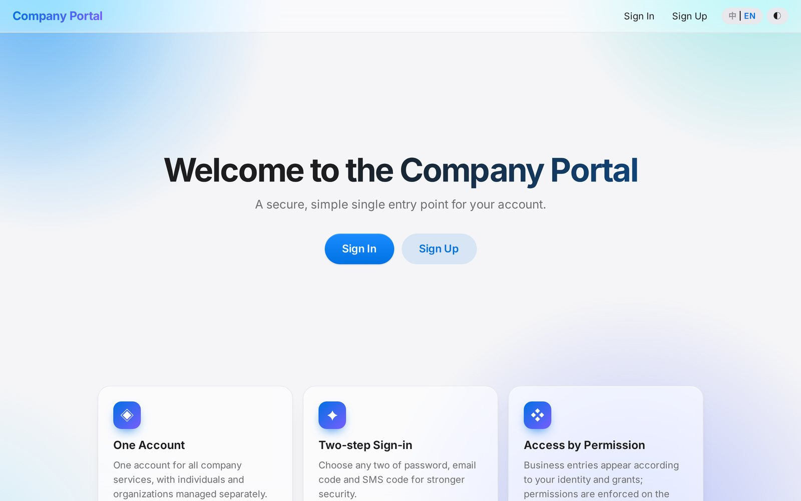
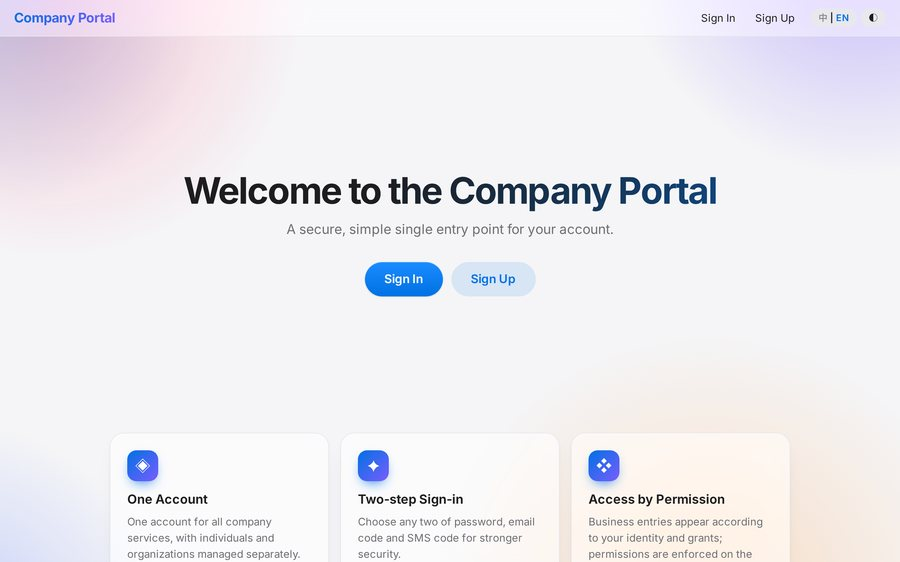
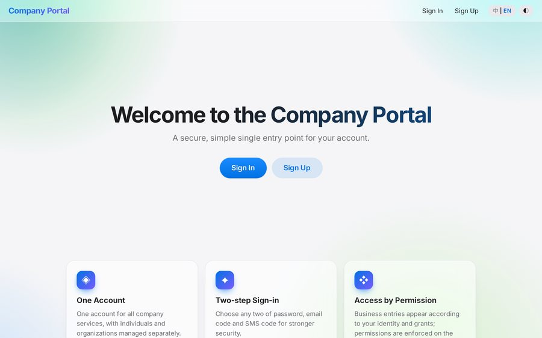
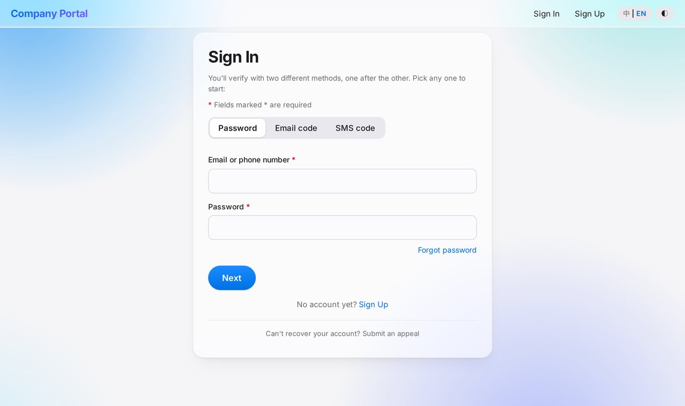
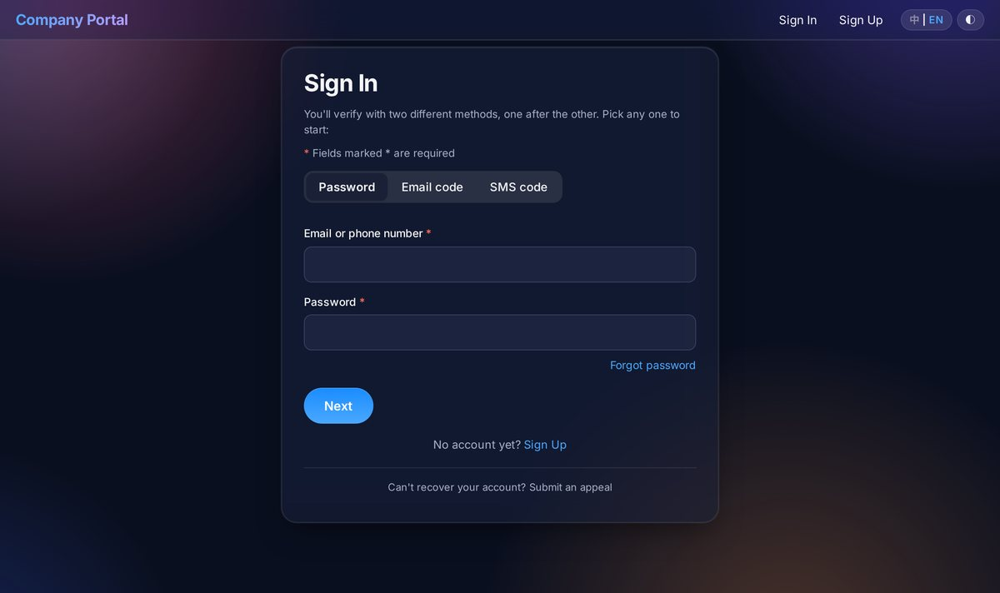
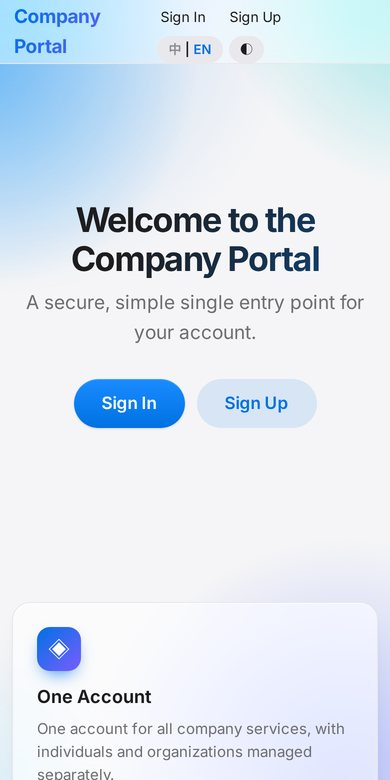

<p align="right"><b>English</b> | <a href="README.zh-CN.md">中文</a></p>

# ✨ apple-glass-ui

> **One formula for every design scenario.**
> Copy, paste, take off. Your site stops being "usable" and starts feeling *expensive*.

Give any server-rendered site (Thymeleaf / any template engine + a sprinkle of JS, **no build step, no framework**) a complete Apple-style look in one go:

| | |
|---|---|
| 🧊 **Real frosted glass** | Translucent surfaces + `backdrop-filter`, over a colorful backdrop so the glass is actually visible |
| 🌌 **5 swappable backgrounds** | Aurora / Dusk / Ocean / Mint / Plain, one click to switch; dark mode is deep navy, not dead black |
| 🔤 **Inter + Noto Sans SC** | Self-hosted, free for commercial use (SIL OFL), good-looking in both English and Chinese |
| 🌐 **EN / 中 corner toggle** | Runtime dictionary translation: no template changes, works with htmx partial updates |
| 🖱️ **Cursor-following glow** | On by default, lightweight; auto-off on touch devices and with "reduce motion" |
| 🧵 **WebGL silk background** | Off by default; politely asks on first visit: "want to try it?" |
| 📜 **Scroll effects** | Scroll reveal, topbar solidify, hero fade; mostly native CSS |
| 👆 **Press feedback** | Ripple, submit loading state, double-submit guard, 60 s resend countdown |

## Preview

<p align="center">
  
</p>
<p align="center"><sub>Recommended default: light blue. Clean and airy, with glass cards floating over a soft gradient.</sub></p>

**Light blue · soft pink · fresh green** (switch from the appearance panel at the top right; "Aurora" and "Plain" are also included)

<p align="center">
  
  
  
</p>

**Frosted-glass form + EN / 中 toggle** (dark mode is deep navy, not pure black)

<p align="center">
  
  
</p>

**Responsive on mobile**

<p align="center"></p>

## Why "formulaic"?

Because it literally is a formula:

```
restrained typography + translucent surfaces + a colored backdrop
+ moderate motion + one switch per preference
= premium feel
```

Login pages, admin panels, marketing sites, event pages, internal tools: apply the formula and you get the same "Apple flavor" every time. No more meetings about whether this page should look nicer.

## Quick start

**As a Claude Code skill**

```bash
git clone https://github.com/meishuhan/apple-glass-ui ~/.claude/skills/apple-glass-ui
```

Then tell Claude: "Make this page Apple-style frosted glass, with an English/Chinese toggle."

**Manual integration**

1. `bash scripts/fetch-fonts.sh` to download the self-hosted fonts
2. Put `assets/app.css`, `assets/ui.js` (and optionally `assets/fabric.js`) into your static directory
3. Include them in `<head>` and add the anti-flash inline script described in `SKILL.md`
4. Copy `assets/i18n-en.sample.json` as your English dictionary

Details, pitfalls and acceptance checks are in [`SKILL.md`](SKILL.md) (written in Chinese).

## Honest notes

- Judge the result on real hardware: frosted glass is power-hungry on low-end devices, which is why the WebGL background is off by default.
- The English strings are a machine-translated first draft; have a human review them before shipping.
- Anything that is Chinese-only on your pages (e.g. emails, SMS) is outside the toggle.
- There is no design that fits *everything*; this one fits everything that wants to be minimal, translucent and a little futuristic.

## License

Code: MIT. Fonts: Inter and Noto Sans SC are both under the SIL Open Font License 1.1; they are downloaded from npm by the script and are not distributed in this repo.
