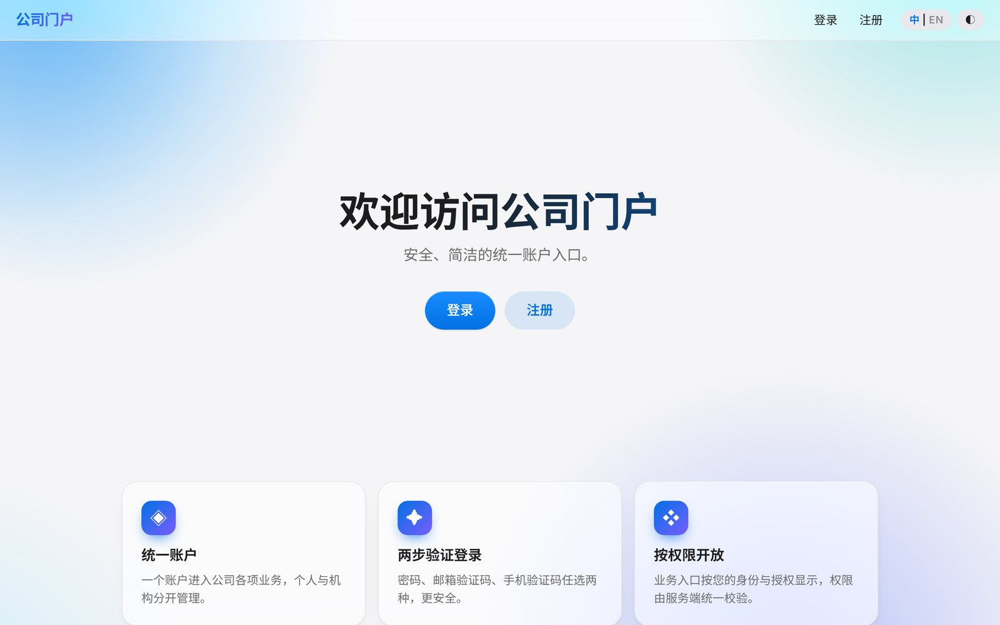
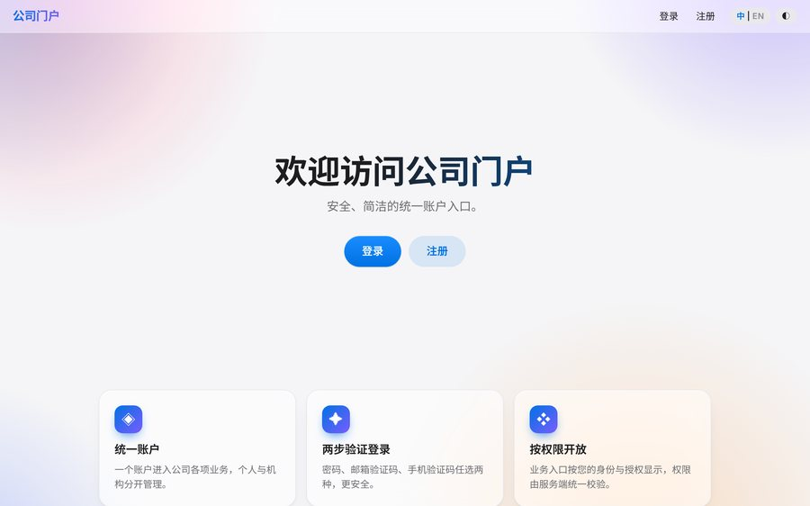
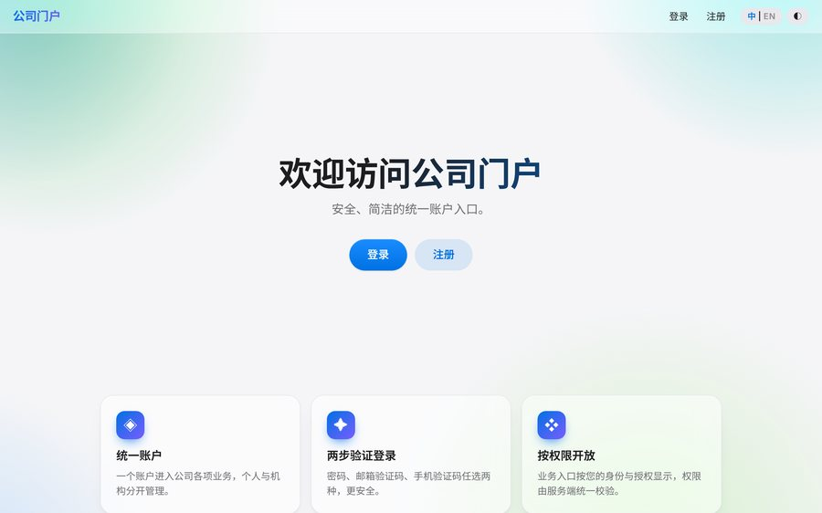
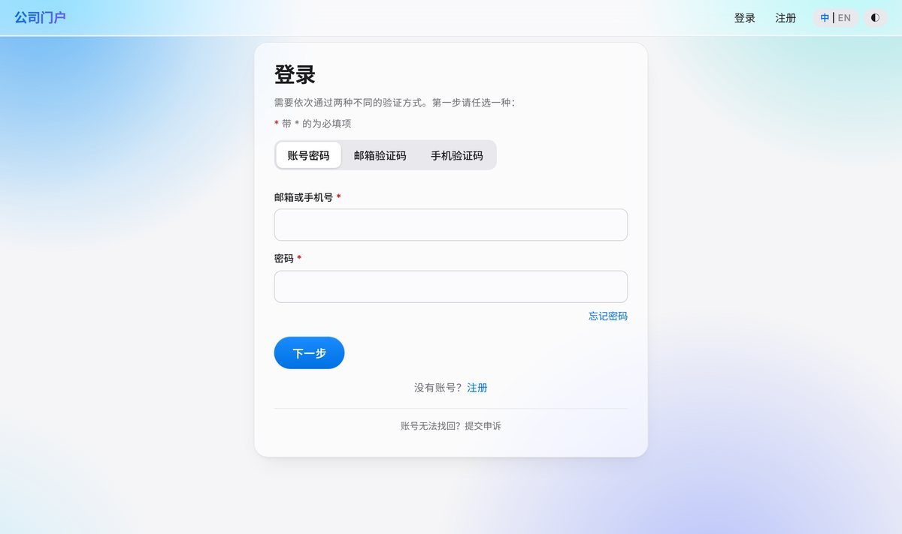
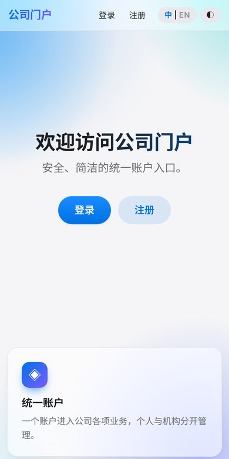

<p align="right"><a href="README.md">English</a> | <b>中文</b></p>

# ✨ apple-glass-ui

> **一套公式，通吃所有设计场景。**
> 复制、粘贴、起飞。从此你的网站不再"能用"，而是"贵"。

给服务端渲染网站（Thymeleaf / 任意模板 + 一点点 JS，**零前端构建、零框架**）一键换上苹果质感的整套界面：

| | |
|---|---|
| 🧊 **真·毛玻璃** | 半透明表面 + `backdrop-filter`，背后有彩色极光，玻璃才看得见 |
| 🌌 **5 种可换背景** | 极光 / 暮色 / 海洋 / 薄荷 / 纯净，一键切换，深色模式是深海蓝而非死黑 |
| 🔤 **Inter + 思源黑体** | 自托管，免费商用（SIL OFL），中英文都耐看 |
| 🌐 **中英文角标切换** | 运行时词典翻译，不改模板，htmx 局部刷新也能翻 |
| 🖱️ **鼠标跟随光斑** | 默认开，轻量，触屏和"减少动态"自动关闭 |
| 🧵 **WebGL 丝绸背景** | 默认关闭，首次访问礼貌询问"要不要试试" |
| 📜 **滚动动效** | 滚动渐显、顶栏渐实、首屏渐隐，原生 CSS 为主 |
| 👆 **按压反馈** | 波纹、提交加载态、防连点、验证码 60 秒倒计时 |

## 先看效果

<p align="center">
  
</p>
<p align="center"><sub>默认推荐：浅蓝。通透、干净，毛玻璃卡片浮在柔和的渐变上。</sub></p>

**浅蓝 · 柔粉 · 嫩绿**（右上角外观面板一键切换，另有"极光"和"纯净"）

<p align="center">
  
  
  
</p>

**毛玻璃表单 + 中英文角标切换**（深色模式是深海蓝，不是死黑）

<p align="center">
  
  
</p>

**手机端自适应**

<p align="center"></p>

## 为什么说它"公式化"

因为它真的是公式：

```
克制的字体 + 半透明表面 + 有色背景 + 有节制的动效 + 一个开关管一个偏好
= 高级感
```

登录页、后台、官网、活动页、内部工具，套这个公式，出来的都是同一种"苹果味"。
不用再为"这页要不要好看一点"开会。

## 快速开始

**作为 Claude Code skill 使用**

```bash
git clone https://github.com/meishuhan/apple-glass-ui ~/.claude/skills/apple-glass-ui
```

然后对 Claude 说："把这个页面做成苹果风毛玻璃，带中英文切换。"

**手动集成**

1. `bash scripts/fetch-fonts.sh` 下载自托管字体
2. 把 `assets/app.css`、`assets/ui.js`（以及可选的 `assets/fabric.js`）放进你的静态目录
3. 在 `<head>` 引入，并参照 `SKILL.md` 加上防闪烁的内联脚本
4. 复制 `assets/i18n-en.sample.json` 为你的英文词典

细节、踩坑清单和验收方法都在 [`SKILL.md`](SKILL.md)。

## 老实话

- 效果以真机为准：毛玻璃在低端设备上较耗电，WebGL 背景因此默认关闭。
- 英文译文是机器初稿，上线前请人工校一遍。
- 页面里只有中文的部分（比如邮件、短信）不在切换范围内。
- 没有"适合一切"的设计；它适合的是"想要简约、通透、有科技感"的一切。

## 许可

代码：MIT。字体：Inter 与 Noto Sans SC 均为 SIL Open Font License 1.1，由脚本从 npm 下载，不随仓库分发。
